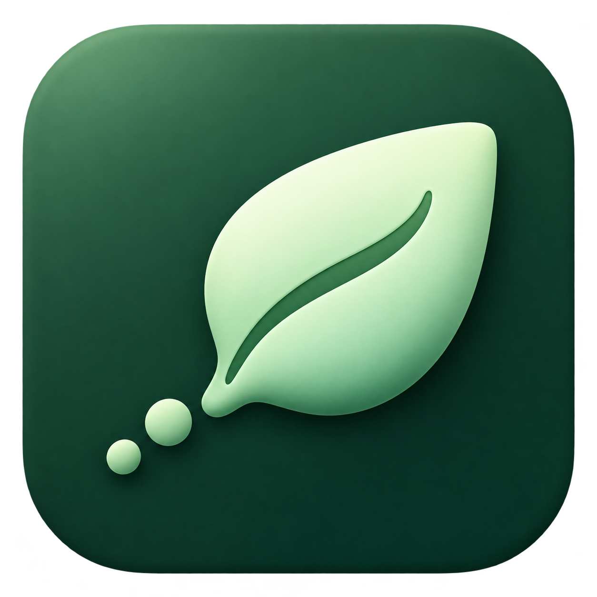

# SeedHop



A native macOS torrent client built with **SwiftUI, AppKit, and Rust**.
The first milestone combines a carefully designed interface with a real
BitTorrent v1 engine, authenticated XPC, and recovery tests.

**Development build:** macOS 15+, Apple Silicon. This is an internal preview,
not a notarized public release. See [validation status](docs/VALIDATION.md) for
the distinction between implemented behavior and verified acceptance criteria.

## Build and run

Requires Xcode 26.3 command-line tools, Python 3.12+, and Rustup.
The pinned Rust toolchain is installed by Rustup if it is not available.

```sh
make build
open .build/SeedHop.app
```

The build script compiles the Rust core, generates matching UniFFI bindings,
compiles the native app and both hosts, bundles the Rust library, and signs
nested code from the inside out. No XcodeGen, Node.js, Homebrew, or web runtime
is required. Swift uses the Swift 6.2 compiler in Swift 5 language mode for the
Foundation XPC interfaces.

Local builds use ad-hoc signing and a development-only library-validation
exception. For certificate-backed validation:

```sh
python3 scripts/build.py --identity 'Apple Development: Your Name (TEAMID)'
```

Release builds omit development flags and the validation exception:

```sh
python3 scripts/build.py --release --identity 'Developer ID Application: Your Name (TEAMID)'
```

Notarization and distribution require your own Developer ID and Apple account.
No certificates, signing keys, credentials, or automatic service registrations
are added by the build script.

## Explore the design

```sh
.build/SeedHop.app/Contents/MacOS/SeedHop --design-preview
make render
```

Design-preview mode uses labeled sample data and cannot issue transfer commands.
The renderer writes light/dark main-window, compact, empty, import, file-selection,
and settings screenshots under `.build/design/`. It renders app-owned views,
not the user's screen. See [design system](docs/DESIGN.md).

## Verify

```sh
make test
make lint
cargo run -p seedhop-core --bin seedhop-lab -- fixture .build/fixture
.build/SeedHop.app/Contents/MacOS/SeedHop --verify-engine "$PWD/.build/fixture"
python3 scripts/interop.py
```

Tests need local socket access. The XPC smoke test uses an isolated library
inside the supplied fixture directory. The interoperability test launches an
isolated qBittorrent profile, verifies a deterministic fixture, and closes that
test process afterward; it does not use your normal qBittorrent profile.

## Structure

- `crates/seedhop-core`: engine adapter, safe storage, state ownership, commands,
  fixtures, and recovery tests.
- `crates/seedhop-ffi`: typed UniFFI interface and runtime ownership.
- `macOS/App`: design system, native interface, XPC client, settings, and renderer.
- `macOS/Host`: shared engine host for foreground XPC and optional launch agent.
- `macOS/Resources`: app icon artwork; all macOS icon sizes are generated at build time.
- `vendor/rqbit`: pinned upstream snapshot with documented, reviewable patches.
- `scripts`: reproducible builds, app icon, and independent peer test.

The app icon and its generation prompt are documented in [icon artwork](docs/ICON.md).

The foreground host is the default. Background mode and login restoration are
separate opt-ins. Downloads are stored in your chosen folder; library state is
under `~/Library/Application Support/SeedHop`. The app does not enable a local
HTTP control server. BitTorrent v2, encrypted peers, RSS, search, remote control,
and advanced queueing remain roadmap work.

## License

Apache-2.0. Upstream notices are retained. Dependency licenses are listed in
[third-party notices](THIRD_PARTY_NOTICES.md).
